<p align="center">
  
</p>

<p align="center">
  
</p>

<p align="center">
  
  
  
  
</p>

## Overview

A NestJS learning project exploring modules, dependency injection, persistence and real-time features. It combines Mongoose/MongoDB and TypeORM, WebSockets and static file serving in a single playground.

## Highlights

- Modular NestJS architecture
- Mongoose and TypeORM persistence examples
- WebSocket gateway
- Static asset serving
- Unit and e2e test setup

## Tech stack

<p align="center">
  
</p>

## Getting started

**Prerequisites:** Node.js 20+ and MongoDB.

```bash
npm install
npm run start:dev
```

---

<p align="center">
  
</p>

<p align="center">
  Built by <a href="https://github.com/Skander-Bardaoui"><b>Skander Bardaoui</b></a> ·
  <a href="https://skander-bardaoui.netlify.app/">Portfolio</a> ·
  <a href="https://github.com/Skander-Bardaoui?tab=repositories">All repositories</a>
</p>
